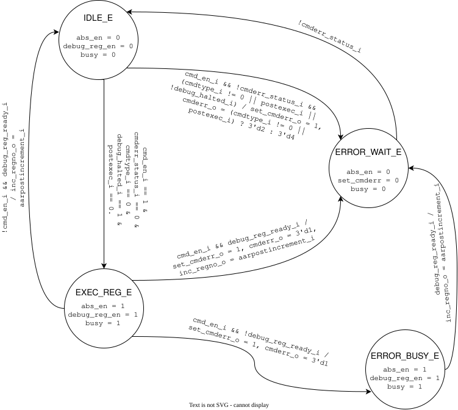

# `meds_s1_abs_ctrl`

| | |
|---|---|
| **Status** | COMPLETE |
| **Owner** | [husnainjatoi](https://www.github.com/husnainjatoi) |
| **Backup** | [MuhammadYousaf79](https://github.com/MuhammadYousaf79) |
| **Project** | R-06 |
| **Spec** | SPEC §13, INTERFACES.md §7 |
| **Source** | `rtl/debug/meds_s1_abs_ctrl.sv` |
| **Testbench** | `verif/unit/tb_meds_s1_abs_ctrl.sv` |

## Purpose

FSM to manage abstract command execution, interacting with debug registers. It isolates the abstract command execution logic from the top-level debug module, ensuring proper sequencing, error code reporting (`cmderr` codes 1, 2, and 4), and state recovery when interfacing with the core.

## Interface contract

| Signal | Dir | Width | Meaning | Contract |
|---|---|---|---|---|
| `clk_i` | in | 1 | clock | single domain |
| `rst_ni` | in | 1 | reset | async assert, sync de-assert |
| `cmd_en_i` | in | 1 | command enable | initiates command execution |
| `cmdtype_i` | in | 8 | command type | valid when `cmd_en_i` is high |
| `postexec_i` | in | 1 | post execution | traps to error (`3'd2`) if requested |
| `cmderr_status_i` | in | 1 | error status | non-zero `abstractcs.cmderr` indicator |
| `debug_halted_i` | in | 1 | core halted | core must be halted for register execution |
| `debug_reg_ready_i` | in | 1 | reg access ready | handshakes completion of register access |
| `aarpostincrement_i` | in | 1 | auto-increment | read on completion |
| `abs_en_o` | out | 1 | abstract enable | high only during active register execution |
| `debug_reg_en_o` | out | 1 | reg access enable | high during register execution |
| `busy_o` | out | 1 | busy flag | high during active execution, low in error wait |
| `set_cmderr_o` | out | 1 | set command error | pulses on transition into error state |
| `cmderr_o` | out | 3 | error encoding | `3'd1` (busy), `3'd2` (not supp), `3'd4` (halt/resume) |
| `inc_regno_o` | out | 1 | increment register | Mealy output on completion |

**Handshake:** Execution waits for `debug_reg_ready_i` before returning to `IDLE_E` (or `ERROR_WAIT_E` if interrupted while busy).
**Latency:** Variable depending on core register access time.
**Backpressure:** Asserts `busy_o` during `EXEC_REG_E` and `ERROR_BUSY_E`.
**Reset state:** Enters `IDLE_E`, all outputs default to `0`.

## Parameters

| Parameter | Default | Legal range | Effect |
|---|---|---|---|
| None | | | |

## Behaviour

The FSM implements four states: `IDLE_E`, `EXEC_REG_E`, `ERROR_BUSY_E`, and `ERROR_WAIT_E`. It transitions from `IDLE_E` to `EXEC_REG_E` only if `cmdtype_i == 8'h0`, the core is halted (`debug_halted_i`), and `postexec_i` is not requested. If an unsupported command or `postexec_i` is requested, it pulses `set_cmderr_o` with `cmderr_o = 3'd2` and enters `ERROR_WAIT_E`. If the hart is not halted, it pulses `set_cmderr_o` with `cmderr_o = 3'd4` and enters `ERROR_WAIT_E`. If a new `cmd_en_i` arrives during `EXEC_REG_E`, it pulses `set_cmderr_o` with `cmderr_o = 3'd1` (`CMDERR_BUSY`) and completes the in-flight register access in `ERROR_BUSY_E` before waiting in `ERROR_WAIT_E` for `cmderr_status_i` to clear. `abs_en_o` is deasserted in `ERROR_WAIT_E`.

## Exceptions and errors

Raises `set_cmderr_o` with `cmderr_o = 3'd2` (not supported), `3'd4` (halt/resume), or `3'd1` (busy). The debugger must clear `abstractcs.cmderr` via DMI (W1C) to return the FSM from `ERROR_WAIT_E` to `IDLE_E`.

## Verification status

| Layer | Status | Where |
|---|---|---|
| Lint | clean | |
| Unit test | 29 checks | `verif/unit/tb_meds_s1_abs_ctrl.sv` |
| Co-simulation | not applicable | |
| Formal | | |

## Known limitations

Only `cmdtype_i == 8'h0` (Access Register without Program Buffer) is supported; other commands return `CMDERR_NOT_SUPP` (`3'd2`).

## Open questions

None.