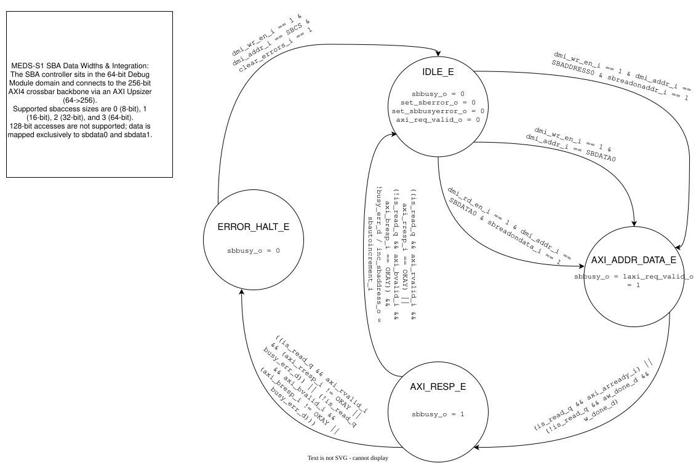

# `meds_s1_sba_ctrl`

| | |
|---|---|
| **Status** | COMPLETE |
| **Owner** | [husnainjatoi](https://www.github.com/husnainjatoi) |
| **Backup** | [MuhammadYousaf79](https://github.com/MuhammadYousaf79) |
| **Project** | R-06 |
| **Spec** | SPEC §13, INTERFACES.md §7 |
| **Source** | `rtl/debug/meds_s1_sba_ctrl.sv` |
| **Testbench** | `verif/unit/tb_meds_s1_sba_ctrl.sv` |

## Purpose

FSM to manage System Bus Access (SBA) execution for the Debug Module. It bridges the 64-bit Debug Module domain to the 256-bit AXI4 crossbar backbone via an AXI Upsizer, supporting 8-bit, 16-bit, 32-bit, and 64-bit accesses.

## Interface contract

| Signal | Dir | Width | Meaning | Contract |
|---|---|---|---|---|
| `clk_i` | in | 1 | clock | single domain |
| `rst_ni` | in | 1 | reset | async assert, sync de-assert |
| `dmi_en_i` | in | 1 | DMI enable | high for active DMI request |
| `dmi_wr_en_i` | in | 1 | DMI write enable | determines read/write context |
| `dmi_rd_en_i` | in | 1 | DMI read enable | determines read/write context |
| `dmi_addr_i` | in | 8 | DMI address | targets SBA registers (`0x37`–`0x3F`) |
| `sbreadonaddr_i` | in | 1 | read on addr | config flag to auto-trigger reads |
| `sbreadondata_i` | in | 1 | read on data | config flag to auto-trigger reads |
| `sbautoincrement_i` | in | 1 | auto increment | flag to pulse `inc_sbaddress_o` |
| `clear_errors_i` | in | 1 | clear errors | recovers from `ERROR_HALT_E` |
| `sbbusy_o` | out | 1 | SBA busy | high when AXI transaction is active |
| `set_sberror_o` | out | 1 | set SBA error | pulses on AXI error response |
| `set_sbbusyerror_o` | out | 1 | set busy error | pulses if illegal SBA DMI access hits while busy |
| `inc_sbaddress_o` | out | 1 | increment addr | pulses upon successful transaction |
| `axi_arready_i` | in | 1 | AXI AR ready | read address handshake |
| `axi_awready_i` | in | 1 | AXI AW ready | write address handshake |
| `axi_wready_i` | in | 1 | AXI W ready | write data handshake |
| `axi_rvalid_i` | in | 1 | AXI R valid | read data valid |
| `axi_rresp_i` | in | 2 | AXI R response | read response status |
| `axi_bvalid_i` | in | 1 | AXI B valid | write response valid |
| `axi_bresp_i` | in | 2 | AXI B response | write response status |
| `axi_req_valid_o` | out | 1 | AXI req active | high during address/data phase |
| `axi_is_read_o` | out | 1 | AXI direction | `1` for read, `0` for write |
| `axi_arvalid_o` | out | 1 | AXI AR valid | read address valid |
| `axi_awvalid_o` | out | 1 | AXI AW valid | write address valid (tracked independently) |
| `axi_wvalid_o` | out | 1 | AXI W valid | write data valid (tracked independently) |
| `axi_rready_o` | out | 1 | AXI R ready | asserted in `AXI_RESP_E` when `is_read_q == 1` |
| `axi_bready_o` | out | 1 | AXI B ready | asserted in `AXI_RESP_E` when `is_read_q == 0` |

**Handshake:** Standard AXI4 valid/ready handshaking with independent `AW` and `W` completion tracking (`aw_done_q`, `w_done_q`) and direction-qualified `R`/`B` response handshaking.
**Latency:** Variable depending on the AXI4 backbone arbitration and memory response.
**Backpressure:** Asserts `sbbusy_o` during transactions. Writes to `SBADDRESS*` or accesses to `SBDATA*` while busy assert `set_sbbusyerror_o` while allowing the in-flight AXI transaction to finish cleanly before halting in `ERROR_HALT_E`.
**Reset state:** Enters `IDLE_E`, all outputs default to `0`.

## Parameters

| Parameter | Default | Legal range | Effect |
|---|---|---|---|
| None | | | |

## Behaviour

The FSM implements four states: `IDLE_E`, `AXI_ADDR_DATA_E`, `AXI_RESP_E`, and `ERROR_HALT_E`. Transactions are initiated on writes to `SBDATA0` (`0x3C`), writes to `SBADDRESS0` (`0x39`) when `sbreadonaddr_i` is set, or reads from `SBDATA0` (`0x3C`) when `sbreadondata_i` is set. During writes in `AXI_ADDR_DATA_E`, `axi_awvalid_o` and `axi_wvalid_o` are tracked independently so `axi_awready_i` and `axi_wready_i` may arrive in the same cycle or in different cycles. In `AXI_RESP_E`, `axi_rvalid_i` is accepted only when `is_read_q == 1` (with `axi_rready_o == 1`) and `axi_bvalid_i` is accepted only when `is_read_q == 0` (with `axi_bready_o == 1`). Status polling of `SBCS` (`0x38`) and unrelated DMI accesses while `sbbusy_o == 1` do not trigger errors.

## Exceptions and errors

Raises `set_sberror_o` if the AXI response is not `AXI_OKAY` (`2'b00`). Raises `set_sbbusyerror_o` if a write to `SBADDRESS0..3` or a read/write to `SBDATA0..3` arrives while `sbbusy_o == 1`. In both cases, the controller completes the active AXI transaction and then enters `ERROR_HALT_E` until `clear_errors_i` is written via `SBCS`.

## Verification status

| Layer | Status | Where |
|---|---|---|
| Lint | clean | |
| Unit test | 32 checks | `verif/unit/tb_meds_s1_sba_ctrl.sv` |
| Co-simulation | not applicable | |
| Formal | | |

## Known limitations

128-bit accesses are not supported; data is mapped exclusively to `sbdata0` and `sbdata1`.

## Open questions

None.